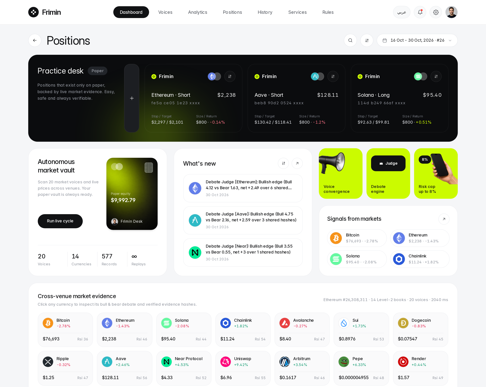

<div align="center">

# Frimin

**Autonomous Market-Evidence Interpreter, Multi-Voice Narrative Convergence Engine, and Level-2 Practice Trading Desk with SHA-256 + Ed25519 Cryptographic Auditability**

[](https://github.com/AbdullahBalfaqih/Frimin/actions/workflows/ci.yml)


[](./LICENSE)

<br />



</div>

---

## Overview

**Frimin** is an institutional-grade autonomous market-intelligence and paper-trading desk engineered for compliance, deterministic reproducibility, and cryptographic auditability. Rather than delegating capital decisions to opaque, non-reproducible black-box prompts or executing synthetic mid-price fills, Frimin strictly separates **live multi-source evidence ingestion** from a **pure, zero-randomness decision kernel**.

In every autonomous cycle, Frimin:

1. Ingests live spot candles, cross-venue tickers, perpetual funding and open interest, and real **Level-2 order books** across **14 liquid digital assets**.
2. Queries **Ethereum Mainnet** and **Solana Mainnet** JSON-RPC nodes directly to decode live ERC-20 whale transfers across major exchange hot wallets.
3. Parses **20 independent market voices** across public Telegram intelligence channels and institutional research RSS/Atom streams.
4. Evaluates candidate theses through a published rulebook: clause-scoped sentiment and hedging analysis, a distinct-voice **Narrative Convergence Index (`NCI`)**, **Symmetric Bull vs. Bear Adversarial Debate** adjudicated by an **Impartial Judge**, a **News Verifier**, and a **5-Gate DexScreener Token Scanner**.
5. Walks live **Level-2 bid/ask ladders** tick-by-tick to compute volume-weighted paper execution prices, slippage in basis points, and `5 bps` institutional taker fees under hard portfolio risk guardrails—while explicitly recording every refused setup and the exact gate that blocked it.
6. Commits every observation, debate transcript, fill, exit, and refusal into a canonical-JSON **SHA-256 hash chain** asymmetrically signed with **Ed25519** and persisted in **SQLite WAL**, enabling **100% bit-for-bit deterministic replay** of any historical cycle.

---

## Hackathon and Sponsors Acknowledgment

Frimin was architected and built for the **BLI Legal Tech Hackathon 2**, hosted on **[DoraHacks](https://dorahacks.io/)**, organized by the **[Blockchain Legal Institute (BLI)](https://bli.tools/)**, and submitted to the **$6,000 USD Autonomous Agents Bounty** sponsored by **RYO-CHAN**.

| Entity | Role |
| :--- | :--- |
| **[Blockchain Legal Institute (BLI)](https://bli.tools/)** | Official Organizer — *BLI Legal Tech Hackathon 2* |
| **RYO-CHAN** | Bounty Sponsor — *$6,000 USD Autonomous Agents Track & Multi-KOL Narrative Spotlight* |
| **[DoraHacks](https://dorahacks.io/)** | Hackathon Infrastructure & BUIDL Submission Platform |

---

## System Architecture

```text
+---------------------------------------------------------------------------------------------------+
|                                   LIVE EVIDENCE INGESTION LAYER                                   |
+-------------------------------+-----------------------------------+-------------------------------+
|   Multi-Venue CEX & Perps     |     Direct Blockchain RPC & DEX   |    20 Curated Market Voices   |
| - Coinbase Hourly OHLCV       | - Ethereum Mainnet JSON-RPC       | - 16 Public Telegram Streams  |
| - Coinbase Level-2 Orderbooks |   (eth_blockNumber, eth_getLogs)  |   parsed via Cheerio DOM      |
| - Kraken Cross-Venue Tickers  | - Solana Mainnet RPC (getSlot)    | - 4 Institutional RSS Feeds   |
| - Hyperliquid Mark/Funding/OI | - DexScreener Live Pair Discovery |   parsed via fast-xml-parser  |
+---------------+---------------+-----------------+-----------------+---------------+---------------+
                |                                 |                                 |
                +---------------------------------+---------------------------------+
                                                  |
                                                  v
+---------------------------------------------------------------------------------------------------+
|                          PURE DETERMINISTIC INTELLIGENCE KERNEL (ZERO RNG)                        |
|                                                                                                   |
|  1. Technical Telemetry       Wilder RSI-14, ATR-14, MACD 12/26/9, Bollinger 20/2, SMA-20, VWAP   |
|  2. Clause-Level NLP          Polarity lexicons, conviction cues, hedge penalties, voice trust    |
|  3. Narrative Convergence     Distinct-voice clustering (NCI >= 48/100, >= 2 independent voices)  |
|  4. Adversarial Courtroom     Symmetric Bull & Bear Agents over shared SHA-256 hashes + Judge     |
|  5. Specialist Sub-Agents     On-Chain Whale Classifier, News Verifier, 5-Gate Token Scanner      |
+-------------------------------------------------+-------------------------------------------------+
                                                  |
                                                  v
+---------------------------------------------------------------------------------------------------+
|                        PRE-TRADE RISK GUARDRAILS & LEVEL-2 PAPER EXECUTION                        |
|                                                                                                   |
|  - $10,000 Paper Vault | Max 8% ($800) / Trade | Max 35% Total Exposure | Max 4 Open Positions   |
|  - 1% ($100) Equity Risk Sizing via ATR-14 | 5% Daily Drawdown Breaker | 8h Asset Cooldown        |
|  - Tick-by-tick Level-2 Orderbook Depth Walk -> Exact VWAP Fill, Slippage (bps) & 5 bps Taker Fee |
|  - Explicit Refusal Accounting: Every blocked candidate logs the exact risk or spread gate failed |
+-------------------------------------------------+-------------------------------------------------+
                                                  |
                                                  v
+---------------------------------------------------------------------------------------------------+
|                     CRYPTOGRAPHIC NOTARIZATION & BIT-FOR-BIT REPLAY LEDGER                        |
|                                                                                                   |
|  - Canonical Key-Sorted JSON -> SHA-256 Hash Chain (prevHash -> hash + causedByHash + evidence)   |
|  - Asymmetric Ed25519 Block Signatures (Node.js native crypto, isolated 0600 notary keypair)      |
|  - Dual Persistence: ACID SQLite WAL (data/frimin.db) + Append-Only JSONL (data/trail.jsonl)      |
|  - Deterministic CLI Verifier & Bit-for-Bit Historical Cycle Replay (`npm run verify` / `replay`) |
+---------------------------------------------------------------------------------------------------+
```

---

## Core Engineering Subsystems

### 1. Multi-Venue Telemetry and Level-2 Orderbook Execution (`src/lib/live-sources.ts`)
- **Cross-Venue Price Integrity:** Simultaneously queries **Coinbase Exchange** (hourly OHLCV candles), **Kraken** (cross-venue spot verification), and **Hyperliquid** (perpetual mark prices, 8-hour funding rates, and open interest) across 14 tracked markets (`BTC`, `ETH`, `SOL`, `LINK`, `AVAX`, `SUI`, `DOGE`, `XRP`, `AAVE`, `NEAR`, `UNI`, `ARB`, `PEPE`, `RENDER`). Any venue dislocation above `1.25%` halts automatic entry.
- **Real Level-2 Depth Walking (`walkOrderBookDepth`):** Pulls live `?level=2` bid/ask order books from Coinbase and sweeps resting liquidity level-by-level for the exact notional size of each paper trade, computing realistic volume-weighted average fill prices (VWAP), spread cost, depth slippage in basis points, and `5 bps` taker fees.

### 2. Direct Ethereum and Solana Mainnet RPC Scanner (`src/lib/live-sources.ts`)
- Connects directly to **Ethereum Mainnet JSON-RPC** (`eth_blockNumber`, `eth_gasPrice`, and `eth_getLogs`) to decode canonical ERC-20 `Transfer(address,address,uint256)` events across `WBTC`, `WETH`, `LINK`, `AAVE`, `UNI`, and `PEPE`, alongside **Solana Mainnet RPC** (`getSlot`).
- Classifies institutional custody movements into and out of known Binance, Coinbase, Kraken, OKX, and Bybit hot-wallet addresses, surfacing direct Etherscan transaction proof links in the UI.

### 3. 20-Voice Narrative Convergence Index (`src/lib/intelligence.ts`, `src/lib/rulebook.ts`)
- Tracks an editable roster of **20 real-world market voices** spanning on-chain whale trackers, quantitative research desks, DeFi security monitors, exchange catalyst feeds, and macro wires.
- Evaluates posts at the clause level so multi-asset statements (for example, bearish on `ETH` while bullish on `SOL` in the same sentence) receive independent per-asset polarity, conviction, urgency, and hedging-penalty scores.
- Computes the **Narrative Convergence Index (`NCI`)** over a rolling `24h` window, strictly requiring at least `2` distinct independent voices before qualifying a narrative thesis (`NCI >= 48/100`). Single-voice spam cannot trigger convergence regardless of post volume.
- Dynamically updates each voice's trust multiplier (`0.55x` to `1.75x`) as historical calls are graded against realized forward spot returns.

### 4. Symmetric Bull vs. Bear Debate and Impartial Judge (`src/lib/intelligence.ts`)
- For every tracked asset, a **Bull Agent** and a **Bear Agent** assemble weighted quantitative arguments over the **exact same array of SHA-256 evidence hashes** (RSI-14, MACD histogram, Bollinger `%B`, 24h VWAP, perpetual funding/OI, cross-venue spread, `NCI` clusters, verified news, and Mainnet whale flows).
- An **Impartial Judge** computes net evidentiary margin and issues a transparent `LONG`, `SHORT`, or `HOLD` ruling committed directly to the audit trail.

### 5. Specialist Screening and Bounded Paper Risk Engine (`src/lib/intelligence.ts`)
- **5-Gate DexScreener Token Scanner:** Evaluates live DEX pairs across five explicit quantitative gates (minimum `$100,000` liquidity, `$75,000` 24h volume, healthy FDV-to-liquidity ratio, balanced buy/sell flow, and sustainable 24h velocity), recording full pass/fail rationale for both selected and rejected tokens.
- **Hard Risk Guardrails:** Enforces `$10,000` initial paper equity, `8.0%` (`$800`) maximum single-position size, `35.0%` (`$3,500`) maximum aggregate exposure, `4` maximum concurrent positions, `1.0%` (`$100`) equity risk sizing at stop distance, `36h` time stops, `8h` per-token cooldowns, and a `5.0%` daily drawdown circuit breaker.

### 6. Cryptographic Audit Trail and Bit-for-Bit Replay (`src/lib/crypto-trail.ts`, `src/lib/sqlite-db.ts`)
- Every record is serialized via recursive key-sorted canonical JSON, hashed with **SHA-256** (`prevHash -> hash` plus causal `causedByHash` and `evidenceHashes`), and signed with an isolated **Ed25519** audit-notary keypair.
- Modifying a single byte of any historical payload, hash link, or signature causes `npm run verify` to fail immediately at the exact tampered block index.
- Raw cycle inputs are archived in **SQLite WAL** (`replay_bundles`), allowing `npm run replay` to re-execute convergence detection, Bull/Bear/Judge debates, and token gates offline and prove `100%` bit-for-bit determinism.

---

## Tools, Protocols, and Ecosystem Stack

Frimin is built on battle-tested open-source libraries, cryptographic primitives, and live public market infrastructure:

### Core Framework and Interface
- **[Next.js 14](https://nextjs.org/)** & **[React 18](https://react.dev/)** — Full-stack App Router analytical desk and deterministic API execution routes.
- **[TypeScript 5.7](https://www.typescriptlang.org/)** — End-to-end static typing across telemetry, intelligence, risk, and cryptographic modules.
- **[Tailwind CSS](https://tailwindcss.com/)**, **[Inter Typeface](https://rsms.me/inter/)**, & **[Lucide](https://lucide.dev/)** — Calm, high-density Bento interface with strict typographic hierarchy and bilingual (`English` / `Arabic` RTL) support.

### Persistence, Cryptography, and Quantitative Analysis
- **[better-sqlite3](https://github.com/WiseLibs/better-sqlite3)** — Synchronous, ACID-compliant **SQLite Write-Ahead Logging (WAL)** persistence for trail blocks, market snapshots, signals, positions, and replay bundles.
- **[Node.js Web/Native Crypto](https://nodejs.org/api/crypto.html)** — Canonical `SHA-256` digest chaining and asymmetric `Ed25519` block signatures (`RFC 8032`).
- **[technicalindicators](https://github.com/anandanand84/technicalindicators)** — Institutional `Wilder RSI-14`, `Wilder ATR-14`, `MACD (12, 26, 9)`, `Bollinger Bands (20, 2)`, and `SMA-20` calculations.
- **[cheerio](https://cheerio.js.org/)** & **[fast-xml-parser](https://github.com/NaturalIntelligence/fast-xml-parser)** — Standards-compliant HTML DOM extraction and RSS/Atom XML syndication parsing.
- **[Zod](https://zod.dev/)** — Strict runtime payload and configuration schema validation.

### Live Market Venues and Blockchain Networks
- **[Coinbase Exchange API](https://docs.cdp.coinbase.com/exchange/docs/welcome)** — Live hourly OHLCV candles and `?level=2` order-book depth ladders.
- **[Kraken REST API](https://docs.kraken.com/api/)** — Independent cross-venue spot ticker verification.
- **[Hyperliquid Info API](https://hyperliquid.gitbook.io/hyperliquid-docs/for-developers/api)** — Live perpetual mark prices, 8-hour funding rates, and open interest telemetry.
- **[Ethereum Mainnet JSON-RPC](https://ethereum.org/en/developers/docs/apis/json-rpc/)** & **[Solana Mainnet RPC](https://solana.com/docs/rpc)** — Direct on-chain block/slot height, gas telemetry, and ERC-20 `Transfer` whale log decoding.
- **[DexScreener API](https://docs.dexscreener.com/)** — Live decentralized exchange pair discovery and liquidity/volume telemetry.

---

## Repository Structure

```text
frimin/
├── .github/workflows/
│   └── ci.yml                  # Automated GitHub Actions unit, crypto & build pipeline
├── docs/assets/
│   └── frimin-dashboard.png    # High-resolution interface preview
├── public/
│   ├── coins/                  # Verified vector/raster asset icons
│   ├── fonts/                  # Self-hosted InterVariable.woff2 typeface
│   └── images/                 # Bento visual assets
├── scripts/
│   └── cli.ts                  # CLI runner for live cycles, chain verification & replay
├── src/
│   ├── app/                    # Next.js 14 App Router pages & REST API endpoints
│   │   └── api/
│   │       ├── engine/         # Live cycle execution, post evaluation, voice & risk config
│   │       └── trail/          # Full SHA-256 + Ed25519 + SQLite chain audit & trail feed
│   ├── components/             # Bento analytical desk, drawers, charts & audit views
│   └── lib/
│       ├── types.ts            # Domain & cryptographic data structures
│       ├── rulebook.ts         # Published lexicons, 20 voices & risk parameters
│       ├── live-sources.ts     # Coinbase/Kraken/Hyperliquid/L2/RPC/Telegram/RSS ingestion
│       ├── intelligence.ts     # NCI convergence, Bull/Bear/Judge, scanner & risk engine
│       ├── crypto-trail.ts     # Canonical JSON, SHA-256 chaining & Ed25519 signing
│       ├── sqlite-db.ts        # SQLite WAL schema, atomic writes & replay storage
│       └── engine-store.ts     # Autonomous cycle orchestrator
├── tests/
│   └── engine.test.ts          # 10 unit, orderbook, NLP, SQLite & safety-boundary tests
├── .env.example                # Optional RPC & read-only social token template
├── SECURITY.md                 # Non-custodial paper-trading & notary key isolation policy
└── LICENSE                     # MIT License
```

---

## Quickstart and Verification Protocol

### Prerequisites
- **Node.js** `>= 20.0.0` and **npm** `>= 10.0.0`
- Zero API keys are required. All market, order-book, Mainnet RPC, Telegram web, and RSS streams work out of the box.

### 1. Install Dependencies
```bash
git clone https://github.com/AbdullahBalfaqih/Frimin.git
cd Frimin
npm install
```

### 2. Run the Automated Test Suite
Executes all 10 unit, Level-2 order-book slippage, clause-scoped NLP, distinct-voice convergence, SQLite WAL, cryptographic tamper-detection, and non-custodial source-code boundary tests:
```bash
npm test
```

### 3. Execute a Live Autonomous Cycle via CLI
Pulls live Coinbase/Kraken/Hyperliquid markets, walks 14 Level-2 order books, queries Ethereum and Solana Mainnet RPCs, fetches the 20 voice streams, runs Bull/Bear/Judge debates, evaluates paper positions, and signs new trail blocks into SQLite WAL:
```bash
npm run cycle
```

### 4. Cryptographically Verify the Entire Reasoning Chain
Re-computes every canonical-JSON `SHA-256` digest from scratch, verifies every `prevHash` and `causedByHash` link, validates every `Ed25519` block signature, and audits SQLite row counts:
```bash
npm run verify
```

### 5. Run Deterministic Bit-for-Bit Historical Replay
Loads archived raw cycle inputs from SQLite and re-executes Narrative Convergence, Bull/Bear/Judge debates, and DexScreener 5-gate screening to prove `100%` identical canonical JSON output:
```bash
npm run replay
```

### 6. Launch the Web Analytical Desk
```bash
npm run build
npm run start
```
Open `http://localhost:3000` in your browser to inspect the live Bento desk, interactive asset drawers, voice configuration, adversarial debates, on-chain whale transfers, and cryptographic audit verifier.

---

## Safety and Compliance Boundary

Frimin operates strictly on simulated `$10,000` practice capital walked against real Level-2 market depth. It contains **no** blockchain wallet private keys, **no** seed phrases, and **no** live exchange order-placement routes. See [`SECURITY.md`](./SECURITY.md) for full details on key isolation and automated static safety checks.

---

## License

Released under the [MIT License](./LICENSE). Copyright (c) 2026 Abdullah Balfaqih.
